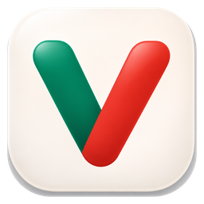

<h1 align="center">VRemote</h1>

โปรแกรมรีโมตเดสก์ท็อปสำหรับ Windows 10/11 x64 ต่อตรงถึงกันเมื่อทำได้ ถ้าต่อตรงไม่ได้จะใช้ Relay

<a href="https://github.com/cuevlife/VRemote-releases/releases/latest"><b>ดาวน์โหลดรุ่นล่าสุด</b></a>

---

## เริ่มใช้งาน

1. ดาวน์โหลด `VRemote-<รุ่น>-Windows-x64.zip` จาก [Releases](https://github.com/cuevlife/VRemote-releases/releases/latest) แตกไฟล์ แล้วเปิด `VRemote.exe` ไม่ต้องติดตั้งอะไรเพิ่ม
2. **เครื่องที่จะให้คนอื่นรีโมตเข้ามา**: ส่งเลขเครื่อง 9 หลักที่แสดงในหน้าหลักให้คนที่ไว้ใจ ตั้งรหัสผ่านเพิ่มก็ได้
3. **เครื่องที่จะรีโมตไปหาเครื่องอื่น**: กรอกเลขเครื่องหรือ IP แล้วกด **เชื่อมต่อ**
4. เจ้าของเครื่องปลายทางต้องกดอนุญาตก่อนทุกครั้ง แล้วจึงเริ่มส่งภาพ

## เส้นทางการเชื่อมต่อ

| เส้นทาง | ใช้เมื่อ |
|---|---|
| **LAN / VPN** | สองเครื่องอยู่ในเครือข่ายเดียวกัน หรือมี route ถึงกัน |
| **Direct** | อยู่ต่างเครือข่าย แต่เจาะ NAT ถึงกันได้ ทางนี้ภาพลื่นที่สุด |
| **Relay** | ต่อตรงไม่ได้ เช่น symmetric NAT หรือ UDP ถูกบล็อก ระบบจะสลับให้อัตโนมัติ |

ระหว่างรีโมต แถบเครื่องมือจะบอกว่ากำลังใช้เส้นทางไหน ถ้าต่อแบบ Direct ไม่สำเร็จ หน้า Debug จะแสดงเหตุผลจากทั้งสองฝั่ง หน้าตั้งค่ามีปุ่มตรวจ Windows Firewall ด้วย ปุ่มนี้ตรวจอย่างเดียว ไม่แก้การตั้งค่า

## ทำอะไรได้บ้าง

- ควบคุมเมาส์และคีย์บอร์ด ถ้าเจ้าของเครื่องขยับเมาส์หรือพิมพ์เอง เจ้าของจะได้สิทธิ์ควบคุมก่อน
- ส่งและรับไฟล์ ทำได้เมื่อเจ้าของเครื่องอนุญาตใน session นั้น
- ส่งข้อความผ่านคลิปบอร์ดได้ทั้งสองทาง ต้องได้รับอนุญาตแยกต่างหาก และใช้ได้เฉพาะข้อความ
- อัปเดตตัวเอง ตรวจลายเซ็นก่อนติดตั้งทุกครั้ง และติดตั้งเองเมื่อไม่ได้ใช้งาน 2 นาที ไม่ตัด session ที่กำลังใช้อยู่
- สั่งอัปเดตเครื่องปลายทางได้จากฝั่งที่รีโมตเข้าไป เจ้าของเครื่องยกเลิกได้ภายใน 30 วินาที ทั้งสองฝั่งต้องใช้รุ่น 1.3.4 ขึ้นไป
- กด `Ctrl+Shift+F12` เพื่อตัดการเชื่อมต่อทันที

ยังไม่รองรับ: ส่งเสียง, ติดตั้งเป็น Windows service, `Ctrl+Alt+Del`, หน้าจอ UAC และหน้าจอล็อก

## ความปลอดภัย

- ทุก session ใหม่ต้องให้เจ้าของเครื่องกดอนุญาตก่อน ถ้าตั้งรหัสผ่านไว้ ต้องกรอกรหัสต่อ รหัสถูกต้องก็ข้ามการกดอนุญาตไม่ได้
- เลขเครื่องไม่ใช่รหัสลับ ก่อนกดอนุญาต ให้ยืนยันกับผู้ขอผ่านช่องทางที่รู้จักก่อน
- ไฟล์อัปเดตต้องผ่านการตรวจ manifest ที่ลงนามด้วย Ed25519 และตรวจ hash ของไฟล์ก่อนติดตั้ง การอัปเดตไม่ใช้ GitHub token ของผู้ใช้
- ลายเซ็นนี้เป็นของโปรเจกต์ ไม่ใช่ Windows Authenticode เปิดครั้งแรก Windows SmartScreen จึงอาจขึ้นคำเตือน

## รุ่น

- รุ่นที่ชื่อลงท้ายด้วย **Stable** ผ่านชุดทดสอบเต็มแล้ว
- รุ่นอื่นเป็นรุ่นปล่อยเร็ว ผ่านเฉพาะชุดทดสอบหลัก
- ดูรายการเปลี่ยนแปลงของแต่ละรุ่นได้ที่ [Releases](https://github.com/cuevlife/VRemote-releases/releases)

## เกี่ยวกับ repository นี้

repository นี้ใช้แจกไฟล์โปรแกรม คำแนะนำ ไฟล์ลิขสิทธิ์ และข้อมูลสำหรับอัปเดต ไม่มี source code ของแอป ถ้าแจกต่อ ให้แนบ `LICENSE`, `THIRD-PARTY-NOTICES.txt` และ `NotoSansThai-OFL.txt` ไปด้วย
